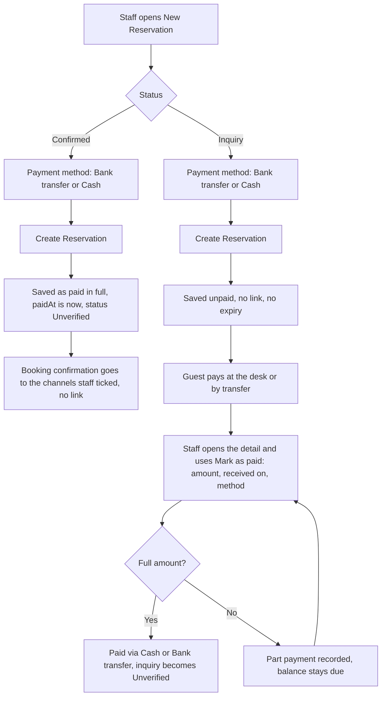
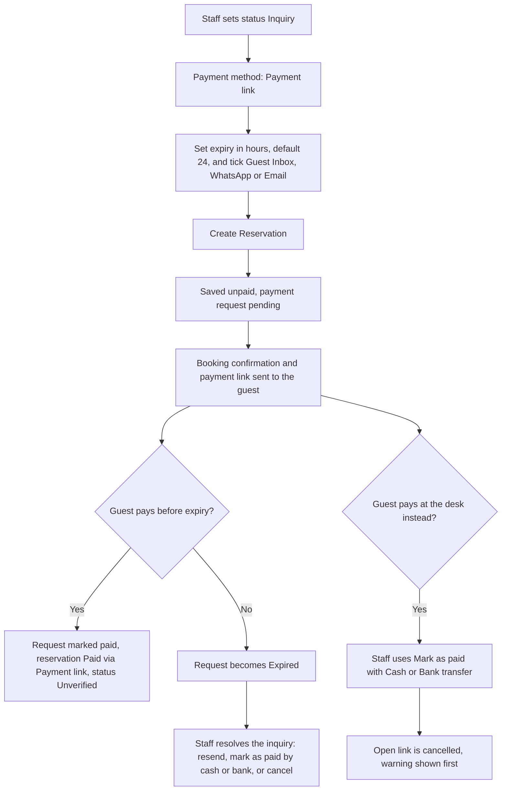

# PRD: Payment method and Business contact on New Reservation

Status key: **Prototype** (built in `elev8-dashboard`, reviewable), **Change** (what the backend and v2 dashboard must add).

Screenshots live in `docs/prd-assets/`.

## 1. Why

Staff create direct reservations for two kinds of guest that the form did not tell apart:
- A **company** books and pays (a retreat operator, a corporate stay). The invoice must carry the company name and tax id, not the person who made the call.
- A booking is **settled at the desk** (bank transfer, cash) instead of through a payment link. The reservation must say how it was paid, otherwise finance cannot reconcile it and staff keep sending links nobody needs.

## 2. Scope

Two additions to **New Reservation** and **Edit reservation**, both shown afterwards in **Reservation detail**:
1. **Payment method** field (Status and Source section).
2. **Personal / Business** tab (Contact Details section).

Out of scope: card capture, refunds, invoice templates per company, currency conversion.

## 3. Payment method

Values: `payment_link`, `bank_transfer`, `cash`.

| Status chosen | Options offered | Default | Effect on save |
|---|---|---|---|
| Confirmed | Bank transfer, Cash | Bank transfer | Recorded as paid in full: `paidAt` = now, `guestPaid` = total. No payment link is sent, only a booking confirmation. |
| Inquiry | Payment link, Bank transfer, Cash | Payment link | Not paid. Payment link gets an expiry (hours). Bank or cash: no link, no expiry, staff mark it paid later. |

Rules
- Switching status resets the method to that status default. A confirmed booking can never keep `payment_link`.
- The Guest Inbox "send payment link" box shows only for an Inquiry paid by link.
- Helper text under the field: "Recorded as paid in full with this method." (Confirmed) or "No payment link is sent. Mark the reservation as paid once the transfer is received." (Inquiry, bank or cash).
- **Mark as paid** in the detail sheet offers Bank transfer and Cash only. A payment link is not a manual method: only the guest paying through the link can produce its invoice.
- Marking as paid cancels any open payment link and says so. A part payment keeps the link open for the rest.
- Paid status uses the existing rule: a paid reservation is **Unverified**, never Verified.

Screenshot: `docs/prd-assets/new-reservation-payment-method.png`

### 3.1 Flow: cash or bank transfer

### 3.2 Flow: payment link

Notes
- Only a guest paying through the link settles it as Payment link. Staff cannot pick it in Mark as paid.
- An inquiry holds its dates only while "Do not block availability" is off.
- Prototype: an expired link only sets the request to Expired. The inquiry is not cancelled automatically, so staff decide. Auto-cancel on expiry is a backend change.

## 4. Business contact

Contact Details has a **Personal | Business** tab, default Personal.

| Field | Personal | Business |
|---|---|---|
| Company Name | hidden | required |
| VAT / Tax ID | hidden | optional, free text |
| First / Last Name | "First Name", "Last Name" | "Contact First Name", "Contact Last Name" (the person booking) |
| Address | "Address" | "Billing Address" |

Rules
- Company name is validated with the other required fields; the form scrolls to it and marks it destructive when empty.
- The Contact Details header shows a **Business** badge while the tab is on Business.
- Saved values: `contactType`, `companyName`, `companyVatId`. Switching back to Personal on save clears company name and tax id.
- Choosing a previous guest fills the company fields too when that guest was a business booking.
- Edit reservation has the same tab with the same rules.

Screenshot: `docs/prd-assets/new-reservation-business-contact.png`

## 5. Reservation detail (after creating)

- Header: guest name, then a line with the building icon, **company name** and **· tax id**. Hidden for Personal.
- Payment accordion, Guest paid view: price breakdown, then a green line **Paid via Bank transfer on 22 Oct 2026**.
- Unpaid reservation (Inquiry by bank or cash): the Mark as paid box with Amount, Received on, Payment method (Bank transfer, Cash) and the button.
- Amounts follow the currency rule: `IDR 5,400,000`, no conversion.

Screenshot: `docs/prd-assets/reservation-detail-business-payment.png`

## 6. Acceptance criteria

1. Confirmed + default method saves with `paymentMethod = bank_transfer`, `paidAt` set, `guestPaid = totalPrice`, and the detail shows "Paid via Bank transfer on <date>".
2. Confirmed never lists Payment link. Inquiry lists all three.
3. Inquiry + cash: no expiry field, no inbox send box, no payment link created.
4. Business tab with an empty company name blocks the save and focuses the field.
5. Business reservation shows company and tax id in the detail header; Personal shows neither.
6. Mark as paid on a reservation with an open link cancels the link and shows the warning first.
7. Edit reservation preserves and can change both fields.

## 7. Change for the backend and v2

- Reservation model: `payment_method` (enum), `paid_at`, `contact_type` (enum personal, business), `company_name`, `company_vat_id`.
- Invoice and PDF export read the company as the bill-to when `contact_type = business`; the contact person stays as the booking contact.
- Reports that split cash and bank settlement read `payment_method`.
- Expired inquiry: the backend decides whether it cancels the reservation and releases the dates when the link expires.
- Migration default: existing rows are `personal`, payment method null (treated as payment link).

## 8. Decisions

- The tax id stays **free text**. No per-country validation (NPWP, VAT, UID).
- A company booking may keep a card saved for damage protection, **under the contact person's name**.
